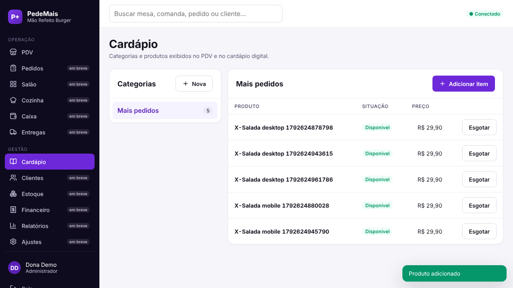

# PedeMais

SaaS multi-tenant para restaurantes: PDV, salão, cozinha (KDS), caixa, cardápio, delivery e gestão, com cada restaurante em `<slug>.pedemais.com`.

> **Estado:** Etapa 2 (fundação técnica) entregue. Fluxos comerciais (pedidos, mesas, KDS, caixa) começam na Etapa 3. Ver [roadmap](docs/roadmap.md).

| Login | Cardápio |
| --- | --- |
|  |  |

## Stack

| Camada | Tecnologia |
| --- | --- |
| Backend | NestJS 11 + TypeScript (monólito modular) |
| Banco | PostgreSQL 16, `tenant_id` + Row-Level Security, Drizzle ORM, migrações SQL versionadas |
| Frontend | React 19 + Vite 7 + TypeScript, Design System próprio, PWA |
| Borda | Traefik (TLS, roteamento por subdomínio) → Nginx (estáticos) / NestJS (`/api`) |
| Infra | Docker, Compose (dev), Swarm + Portainer (prod), rede `network_public` |
| Testes | Vitest, supertest, Playwright |
| CI | GitHub Actions |

Planejado para as próximas etapas: Redis + BullMQ, WebSockets, S3/B2, Focus NFe, WhatsApp. **Não usa Frappe.**

## Estrutura

```
apps/
  api/                NestJS: auth, tenancy, catalog, audit, provisioning, health
    db/migrations/    SQL versionado (RLS, grants, funções)
    test/             testes de integração: RLS, API ponta a ponta, provisionamento
  web/                React + PWA: design-system/, app/, pages/, e2e/
packages/
  shared/             dinheiro, slug de tenant, papéis e permissões
infrastructure/
  docker/             Dockerfiles e init do Postgres (papéis)
  nginx/              configuração do SPA
  swarm/              stack de produção para Swarm/Portainer
scripts/              install.sh, healthcheck.sh
docs/                 arquitetura, análise, roadmap, riscos, ADRs, guias
```

## Começar

```bash
cp .env.example .env    # troque as senhas
docker compose up -d --build
docker compose run --rm -e PROVISION_ADMIN_PASSWORD='uma-senha-forte' migrate \
  node dist/provisioning/provision-cli.js demo "Restaurante Demo" dono@demo.local "Dono Demo"
# abra http://demo.pedemais.localhost:8080
```

Desenvolvimento sem Docker, testes e migrações: [docs/development.md](docs/development.md).

## Segurança multi-tenant em uma frase

O restaurante vem do **Host validado**, a sessão só existe **dentro desse restaurante** (RLS), o banco **recusa** linhas e referências de outro restaurante mesmo se a aplicação errar, e há testes que provam cada uma dessas garantias ([docs/testing.md](docs/testing.md)).

## Documentação

- [Análise inicial](docs/initial-analysis.md) · [Arquitetura](docs/architecture.md) · [Roadmap](docs/roadmap.md) · [Riscos](docs/risks.md) · [Decisões (ADR)](docs/decisions/README.md)
- [Desenvolvimento local](docs/development.md) · [Testes](docs/testing.md) · [Deploy, Swarm, Portainer, Traefik, rollback](docs/deploy.md)
- [Observações do sistema de referência](docs/reference/observations.md)

## Licença

Ainda não definida pelo dono do projeto (código privado). Ver [riscos](docs/risks.md) R3.
