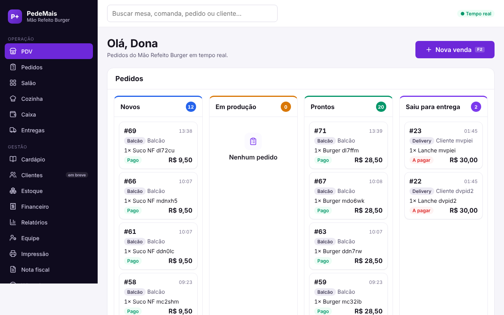
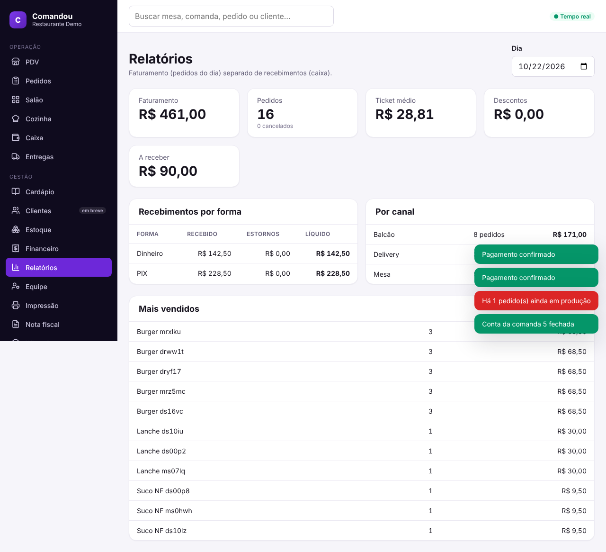
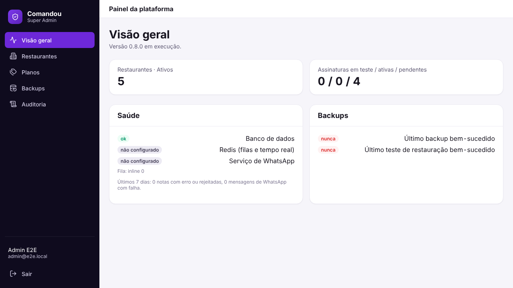

# PedeMais

Sistema para restaurantes, vendido como serviço (SaaS): cada restaurante tem o próprio endereço
(`<restaurante>.pedemais.com` ou um domínio próprio) e usa PDV, salão, cozinha, caixa, cardápio,
entregas, estoque, financeiro, nota fiscal e avisos por WhatsApp. Os dados de um restaurante
nunca aparecem para outro.

| PDV | Relatórios |
| --- | --- |
|  |  |
| **Login** | **Painel Super Admin** |
|  |  |

## O que o sistema faz

| Área | Recursos |
| --- | --- |
| **Venda** | PDV com atalhos de teclado, adicionais e variações, pedidos de balcão, mesa e delivery, descontos com limite por papel |
| **Salão** | Mesas e comandas, transferência, divisão da conta sem perder centavo, fechamento |
| **Cozinha** | Fila por setor de produção (KDS) em tempo real, avanço por item ou pedido |
| **Caixa** | Abertura por terminal, pagamentos com troco, estornos, sangria e suprimento, fechamento conferido |
| **Retaguarda** | Equipe e papéis, estoque com ficha técnica e custo médio, entregadores com rastreio, impressão local (agente ESC/POS), contas a pagar e receber, relatórios |
| **Integrações** | NFC-e pela Focus NFe, avisos ao cliente pelo WhatsApp (QR Code ou API oficial), filas com novas tentativas |
| **SaaS** | Painel Super Admin com dois fatores, planos e limites, domínio próprio verificado por DNS, monitoramento, backups cifrados com teste de restauração |

O histórico de versões aparece no próprio sistema, na tela **Novidades**.

## Garantias

- **Isolamento entre restaurantes.** O restaurante vem do endereço validado, nunca de um campo
  enviado pelo navegador. Todas as tabelas têm `tenant_id` com Row-Level Security no PostgreSQL, e
  o banco recusa ler ou referenciar dados de outro restaurante mesmo se a aplicação errar.
- **Dinheiro sem arredondamento errado.** Valores em decimal (nunca ponto flutuante); pagamento,
  fechamento de pedido e de caixa com chave de idempotência; registro financeiro confirmado nunca
  é apagado, só estornado.
- **Confirmação só depois do servidor.** A tela não mostra pagamento ou operação de caixa como
  confirmados antes da resposta do backend; o aviso em tempo real é só um sinal.
- **Segredos protegidos.** Tokens de integração e sessões do WhatsApp cifrados no banco; senhas,
  cookies e tokens nunca vão para os logs.

Cada garantia tem testes automatizados: ver [docs/testing.md](docs/testing.md).

## Tecnologia

| Camada | Tecnologia |
| --- | --- |
| Backend | NestJS 11 + TypeScript (monólito modular), filas BullMQ, Socket.IO |
| Banco | PostgreSQL 16 com Row-Level Security, migrações SQL versionadas |
| Cache e filas | Redis |
| Frontend | React 19 + Vite 7 + TypeScript, Design System próprio, PWA |
| Borda | Traefik (TLS e roteamento por endereço) → Nginx (arquivos estáticos) e NestJS (`/api`) |
| Infra | Docker, Compose (desenvolvimento), Swarm + Portainer (produção), imagens amd64 e arm64 |
| Qualidade | Vitest, supertest, Playwright, GitHub Actions |

## Estrutura

```
apps/
  api/                API NestJS (auth, restaurantes, cardápio, pedidos, caixa, estoque,
                      entregas, financeiro, nota fiscal, WhatsApp, planos, painel da plataforma)
    db/migrations/    SQL versionado (tabelas, RLS, permissões)
    test/             testes de integração e ponta a ponta
  web/                React + PWA (telas do restaurante e painel Super Admin), e2e/ com Playwright
  whatsapp-gateway/   serviço separado do WhatsApp por QR Code
packages/
  shared/             regras comuns: dinheiro, papéis e permissões, planos, Novidades
tools/
  print-agent/        agente de impressão que roda no computador do restaurante
  load/               testes de carga
infrastructure/       Dockerfiles, Nginx, Traefik, stack do Swarm, backups, alertas
scripts/              instalação, checagem pré-produção, saúde
docs/                 arquitetura, decisões (ADR), operação, deploy, testes
```

## Instalar em um servidor

```bash
curl -fsSL https://raw.githubusercontent.com/dhqdev/pedemais/main/scripts/get.sh | sudo bash
```

AMD64 ou ARM64, com Docker/Swarm, HTTPS e segredos preparados pelo instalador; o Super Admin nasce do
e-mail e da senha que você informa. Detalhes e alternativas: [docs/install.md](docs/install.md).

## Começar em desenvolvimento

```bash
cp .env.example .env    # troque as senhas
docker compose up -d --build
docker compose run --rm -e PROVISION_ADMIN_PASSWORD='uma-senha-forte' migrate \
  node dist/provisioning/provision-cli.js demo "Restaurante Demo" dono@demo.local "Dono Demo"
# abra http://demo.pedemais.localhost:8080
```

Desenvolvimento sem Docker, testes e migrações: [docs/development.md](docs/development.md).

## Documentação

- [Arquitetura](docs/architecture.md) · [Roadmap](docs/roadmap.md) · [Riscos](docs/risks.md) · [Decisões (ADR)](docs/decisions/README.md)
- [Desenvolvimento local](docs/development.md) · [Testes](docs/testing.md) · [Carga](docs/load-testing.md)
- [Instalação](docs/install.md) · [Deploy](docs/deploy.md) · [Operação](docs/operations.md) · [Backups e restauração](docs/backups.md) · [Segurança](docs/security.md)

## Licença

Código privado. A licença ainda não foi definida pelo dono do projeto.
